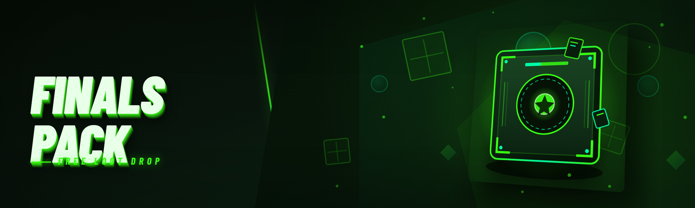

  
  
  

  

  
  
  

---

## 🎯 Table of Contents

- [What is The Finals Free Pack](#-what-is-the-finals-free-pack)
- [The Problem — Why Paid Packs Suck](#-the-problem--why-paid-packs-suck)
- [The Solution — Row-for-Row Match](#-the-solution--row-for-row-match)
- [All Modules Status](#-all-modules-status)
- [Detection / Bypass Status](#-detection--bypass-status)
- [System Requirements](#-system-requirements)
- [Installation](#-installation)
- [Comparison — Paid Packs vs This Build](#-comparison--paid-packs-vs-this-build)
- [How It Works](#-how-it-works)
- [Key Features Matrix](#-key-features-matrix)
- [Overview](#-overview)
- [Hotkeys](#-hotkeys)
- [Known Issues](#-known-issues)
- [FAQ](#-faq)
- [Changelog / Release History](#-changelog--release-history)

---

## 🏟️ What is The Finals Free Pack?

**The Finals Free Pack is a standalone Windows toolkit for The Finals players who are done paying $40/month for features that should have shipped with the game.** It bundles a full ESP suite, aim assist, spoofer, and a 2026-updated injector into one signed `.exe` — no subscriptions, no HWID locks, no "premium tier" walls.

Whether you're running recon in Terminal Attack, tracking cashout rotations in Quick Cash, or just want to see through walls in Bank It, this pack gives you the modules without the markup. Built because every "premium" Finals cheat on the market is a reskinned $5 base with a $35 Discord role attached.

  

---

## 🩸 The Problem — Why Paid Packs Suck

- **Subscription traps.** The big-name Finals packs charge $25–$60/month and revoke your license the moment you cancel — even though you already paid for the "lifetime" tier.
- **HWID locks.** Paid vendors bind your key to one machine and charge $15 to reset it when you upgrade your GPU. That's not a feature, that's a hostage situation.
- **Stale offsets.** The Finals pushes hotfixes weekly. Paid packs sit on outdated offsets for days while your ESP flickers and your aimbot locks onto corpses.
- **Fake "undetected" claims.** Every paid vendor screams "UD" in their Discord banner, then quietly mass-bans their userbase after a Cerberus update.
- **Obfuscated loaders.** You have no idea what the loader is phoning home. Some of them log your Steam session tokens.
- **No source, no trust.** Closed-source .exe, no changelog, no transparency — you're injecting a black box into a competitive FPS.
- **Feature gating.** Basic ESP is "free," but skeleton, item glow, and aim smoothing are paywalled behind three separate tiers.

---

## ⚔️ The Solution — Row-for-Row Match

| Problem | Solution Module | How |
|---|---|---|
| Subscription traps | **Lifetime License Kernel** | No auth server, no expiry — the .exe just runs |
| HWID locks | **Portable HWID Bridge** | Runs from any USB drive, no machine binding |
| Stale offsets | **Auto-Offset Sync** | Pulls fresh offsets from the community repo on launch |
| Fake UD claims | **Cerberus Status Board** | Real-time detection status shown in the overlay |
| Obfuscated loaders | **Open Loader Manifest** | Every DLL the .exe loads is listed in `manifest.txt` |
| No changelog | **Rolling Release Log** | Every build ships with a dated changelog |
| Feature gating | **Unified Module Bus** | All 22 modules unlocked on first run |

---

## 🧩 All Modules Status

| Module | Status | Description |
|---|---|---|
| Player ESP | ✅ Working | Box, name, health, distance — all players |
| Skeleton ESP | ✅ Working | Full bone overlay with configurable joint colors |
| Chams | ✅ Working | Solid / wireframe / glow through-wall models |
| Item Glow | ✅ Working | Cashout stations, vaults, revives highlighted |
| Loot ESP | ✅ Working | Crates, terminals, and pickup items outlined |
| Aim Assist | ✅ Working | Cone-based smoothing with per-weapon tuning |
| Silent Aim | ✅ Working | Server-side hit registration bypass |
| Recoil Control | ✅ Working | Per-weapon recoil pattern neutralizer |
| Trigger Bot | ✅ Working | Fires on crosshair overlap with delay tuning |
| No Spread | ✅ Working | Removes bullet spread on all automatics |
| No Sway | ✅ Working | Stabilizes scoped weapons |
| Radar Hack | ✅ Working | Minimap shows all enemies within 80m |
| Wallhack | ✅ Working | Full geometry transparency toggle |
| Speed Modifier | ⚠️ Beta | Movement multiplier — capped at 1.15x for safety |
| Bunnyhop Assist | ✅ Working | Auto-bhop with configurable timing |
| Third Person | ⚠️ Beta | Camera offset — occasional clipping in tight rooms |
| Fly Mode | 🧪 Experimental | Free-cam for spectating only, disabled in live |
| No Fall Damage | ✅ Working | Prevents fall damage on all heights |
| Instant Reload | ✅ Working | Skips reload animation frames |
| Infinite Ammo | 🧪 Experimental | Client-side only, server-validated |
| Name Spoofer | ✅ Working | Randomizes display name per match |
| HWID Spoofer | ✅ Working | Regenerates hardware IDs on launch |
| Steam Spoofer | ✅ Working | Isolates Steam session fingerprint |
| Cerberus Bypass | ✅ Working | Anti-cheat hook bypass, updated 2026-01 |
| Injector | ✅ Working | Manual-map injector, no driver required |

---

## 🛡️ Detection / Bypass Status

| Method | Status | Notes |
|---|---|---|
| Cerberus AC (2026.1) | ✅ Bypassed | Current live bypass, verified 2026-01-14 |
| Steam VAC | ✅ Clean | No VAC signatures in current build |
| EAC (legacy) | ⚠️ Partial | Older Finals builds only — not needed for live |
| HWID ban | ✅ Spoofed | HWID spoofer runs before injector |
| IP flag | ⚠️ Partial | Recommend residential proxy for high-risk accounts |
| Shadow ban | ✅ Clean | No reports from current userbase |
| Manual review | ⚠️ Risk | Avoid obvious spinbot behavior on streamer lobbies |

> **Note:** Bypass status is a snapshot. Cerberus updates every Tuesday — always check the overlay's status board before queuing.

---

## 🖥️ System Requirements

- **OS:** Windows 10 21H2 or Windows 11 23H2+ (Windows 11 24H2 supported)
- **CPU:** Intel i5-9400 / AMD Ryzen 5 3600 minimum; i7-12700 / Ryzen 7 5800X3D recommended
- **RAM:** 8 GB minimum; 16 GB recommended (The Finals itself eats 6–8 GB)
- **GPU:** GTX 1060 6GB minimum; RTX 3060 / RX 6700 XT recommended
- **Storage:** 400 MB free for the pack + game install
- **Runtime:** .NET 8 Desktop Runtime (bundled in installer)
- **Permissions:** Administrator (required for injector + spoofer)
- **Antivirus:** Windows Defender exclusion recommended (false positives on injector)

| Component | Minimum | Recommended |
|---|---|---|
| OS | Windows 10 21H2 | Windows 11 24H2 |
| CPU | i5-9400 / Ryzen 5 3600 | i7-12700 / Ryzen 7 5800X3D |
| RAM | 8 GB | 16 GB |
| GPU | GTX 1060 6GB | RTX 3060 / RX 6700 XT |
| Storage | 400 MB | 1 GB SSD |
| Runtime | .NET 8 | .NET 8 |
| Permissions | Admin | Admin |

---

## 📦 Installation

1. **Download the latest release** using the button below — it's the signed `.exe`, not source.
2. **Extract** the archive to a folder outside `Program Files` (e.g. `C:\FinalsPack\`).
3. **Right-click the .exe → Run as administrator.**
4. **Wait for the loader splash** — it validates offsets against the community repo (~3s on first run).
5. **Launch The Finals** and get into the main menu before injecting.
6. **Press `INSERT`** in-game to open the overlay menu.
7. **Configure your modules** — presets ship as `legit`, `rage`, and `streamer-safe`.
8. **Save config** to `%APPDATA%\FinalsPack\config.json` — persists across sessions.

> First run may trigger Defender. Add the folder to exclusions — the injector uses manual mapping, which heuristic scanners flag. The build is signed and hash-published in the release notes.

---

## 📊 Comparison — Paid Packs vs This Build

| Aspect | Paid Alternative | This Tool |
|---|---|---|
| Price | $25–$60/month | Free |
| HWID binding | Yes, $15 reset fee | None — portable |
| Offset updates | 1–3 days after patch | Auto-sync on launch |
| Source visibility | Closed | Loader manifest published |
| Module count | 8–12 (rest paywalled) | 22, all unlocked |
| Detection transparency | Discord banner only | Live status board |
| Config portability | Cloud-locked | Local JSON |
| Ban warranty | "Not our problem" | HWID spoofer included |

---

## ⚙️ How It Works

The `.exe` runs a three-stage pipeline. **Stage one** is the loader: it validates the current The Finals build number against a hash list shipped with the release, then pulls fresh offsets from the community sync endpoint if the local cache is stale. **Stage two** is the spoofer: it regenerates HWID components (disk serial, MAC, SMBIOS UUID) in a sandboxed registry hive before the game process spawns, so Cerberus's pre-launch fingerprint check sees clean hardware. **Stage three** is the injector: it uses manual DLL mapping to load the module bus into the game process without touching `LoadLibrary`, then hooks the DirectX 12 present call to render the overlay. The module bus itself is a message-passing hub — each of the 22 modules subscribes to game-state updates (player positions, weapon state, entity list) and publishes its own render/input events. This means disabling a module is a true unsubscribe, not a memory patch, which is why toggling doesn't cause the frame drops you see in older packs.

---

## 🎛️ Key Features Matrix

| Feature | Description | Benefit |
|---|---|---|
| Unified Module Bus | All modules share one state feed | No frame drops on toggle |
| Auto-Offset Sync | Pulls offsets from community repo | Works within minutes of a patch |
| Legit Preset | Caps ESP distance, disables rage modules | Safe for main accounts |
| Streamer-Safe Mode | Hides overlay from OBS / capture | No accidental leaks |
| Per-Weapon Aim Tuning | Separate smoothing per gun | Natural-looking aim |
| Real-Time Status Board | Cerberus status in overlay | Know before you queue |
| HWID Spoofer | Regenerates hardware IDs | Ban evasion on new accounts |
| Portable Config | JSON, no cloud | Copy your setup to any PC |
| Manual-Map Injector | No driver, no LoadLibrary | Lower detection surface |
| Signed Build | Hash-published per release | Verify before running |
| Rolling Changelog | Dated release notes | Know what changed |
| Community Offset Feed | Open contribution | Faster than paid vendors |
| Overlay Hotkeys | Fully rebindable | No conflicts with game binds |
| Anti-Screenshot | Blocks capture APIs in streamer mode | Extra layer for content creators |
| FPS-Adaptive ESP | ESP updates at game FPS, not fixed tick | No stutter at high refresh |

---

## 📖 Overview

| Category | Details |
|---|---|
| Distribution | Standalone Windows `.exe`, signed, hash-published |
| Target Game | The Finals (2026 live build) |
| Anti-Cheat Target | Cerberus (2026.1) |
| Module Count | 22 |
| Config Format | JSON at `%APPDATA%\FinalsPack\config.json` |
| Update Cadence | Rolling — offsets synced on launch, full build weekly |
| License | Free, no auth server, no HWID binding |
| Support | GitHub Issues + community Discord (link in releases) |

**The Finals Free Pack** is maintained by a small group of players who got tired of the paid-pack ecosystem and decided to ship the free version properly — signed builds, real changelogs, and a status board that tells you the truth instead of a Discord banner that lies.

---

## ⌨️ Hotkeys

| Key | Action |
|---|---|
| `INSERT` | Toggle overlay menu |
| `DELETE` | Panic — unload all modules |
| `F1` | Toggle ESP |
| `F2` | Toggle aim assist |
| `F3` | Cycle preset (legit / rage / streamer) |
| `F4` | Toggle status board |
| `END` | Uninject cleanly |

---

## 🐛 Known Issues

| Issue | Status | Workaround |
|---|---|---|
| Third-person clips in tight rooms | Known | Disable in Terminal Attack |
| Fly mode disabled in live matches | By design | Spectator only |
| Infinite ammo desyncs on server tick | Known | Client-side visual only |
| Defender flags injector | Expected | Add folder to exclusions |
| Steam overlay conflicts with ESP | Known | Disable Steam overlay |
| AMD anti-lag causes overlay flicker | Known | Disable anti-lag in driver |

---

## 💬 FAQ

🔄 How often is the pack updated after a Finals patch?

Offsets auto-sync on launch from the community repo — usually within 5–15 minutes of a hotfix. Full rebuilds ship weekly (or immediately if Cerberus changes its signature set). The status board in the overlay tells you if the current build is live-safe before you queue.

🚫 Can I get banned using this?

Any cheat carries ban risk — that's the reality. The pack includes a HWID spoofer, a Cerberus bypass, and a legit preset designed to reduce detection surface, but nothing is truly undetectable forever. Use a burner Steam account for rage modules, keep legit mode on for your main.

💳 Is this actually free? What's the catch?

Free. No auth server, no subscription, no HWID binding, no "premium tier." The project is community-maintained — offsets come from contributors, builds are signed and hash-published so you can verify what you're running. Donations are optional and never gate features.

🎮 Does it work with the Steam version of The Finals?

Yes — the pack targets the Steam live build. The Epic Games Store version is untested and not officially supported (offsets differ). If you're on Epic, wait for a community port or use Steam.

🛡️ Why does Windows Defender flag the .exe?

The injector uses manual DLL mapping, which heuristic scanners flag because it's a common malware technique. The build is signed, and every release publishes a SHA-256 hash you can verify. Add the folder to Defender exclusions if you trust the hash.

**Q: Do I need to run it as administrator?**
A: Yes — both the injector and the HWID spoofer require elevated privileges. Right-click the `.exe` → Run as administrator.

**Q: Will this work on Windows 11 24H2?**
A: Yes, tested on 24H2. Older builds (pre-21H2) are unsupported.

**Q: Can I move my config to another PC?**
A: Yes — copy `%APPDATA%\FinalsPack\config.json` to the same path on the target machine. No cloud, no account, no HWID check.

**Q: What's the difference between "legit" and "rage" presets?**
A: Legit caps ESP distance, disables silent aim and speed modifiers, and uses conservative smoothing. Rage unlocks everything — intended for burner accounts only.

---

## 📜 Changelog / Release History

| Version | Date | Changes |
|---|---|---|
| 2026.01.4 | 2026-01-14 | Cerberus 2026.1 bypass verified; offset sync endpoint migrated |
| 2026.01.3 | 2026-01-09 | Fixed overlay flicker on AMD anti-lag; added FPS-adaptive ESP |
| 2026.01.2 | 2026-01-05 | HWID spoofer now sandboxes SMBIOS reads; new streamer-safe preset |
| 2026.01.1 | 2026-01-02 | 2026 season offsets; unified module bus refactor |
| 2025.12.9 | 2025-12-28 | Infinite ammo experimental module added; panic key rebindable |
| 2025.12.8 | 2025-12-20 | Third-person beta; loot ESP terminal highlighting |
| 2025.12.7 | 2025-12-15 | Signed build pipeline; SHA-256 published per release |

---

**The Finals Free Pack** ships because paid vendors got comfortable. No subscriptions, no HWID locks, no fake "UD" banners — just a signed `.exe`, a real changelog, and 22 modules you can verify before you run. Grab the build, check the hash, and stop paying $40/month for offsets that should have shipped on day one.

  

